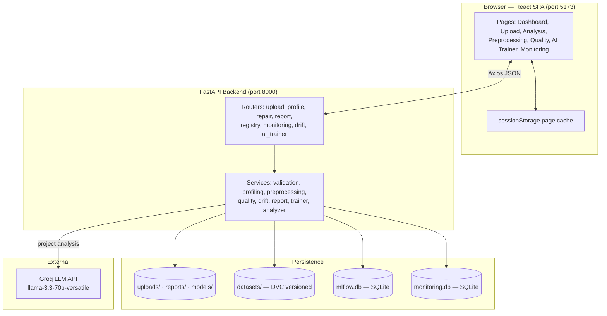
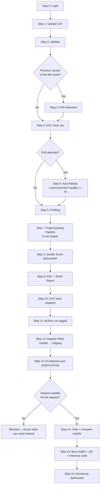

# DataPrep — Complete Workflow Documentation

**Prep · Train · Monitor**

An end-to-end MLOps platform with two main modules:

1. **Dataset Module** — upload → validate → profile → repair → score → report
2. **AI Model Training Module** — describe your goal in plain English → AI picks the configuration → train → compare → download a ready predictor

Everything around those two modules (versioning, experiment tracking, drift detection, auto-retraining, monitoring) runs automatically in the background.

---

## Table of Contents

1. [Architecture at a Glance](#1-architecture-at-a-glance)
2. [Technology Stack](#2-technology-stack)
3. [The Complete Flow](#3-the-complete-flow)
4. [Step-by-Step Breakdown](#4-step-by-step-breakdown)
   - [Step 0 — Login & Session](#step-0--login--session)
   - [Step 1 — Upload](#step-1--upload)
   - [Step 2 — Validation](#step-2--validation)
   - [Step 3 — Drift Detection](#step-3--drift-detection)
   - [Step 4 — DVC Versioning (Raw)](#step-4--dvc-versioning-raw)
   - [Step 5 — Auto-Retraining](#step-5--auto-retraining-conditional)
   - [Step 6 — Profiling](#step-6--profiling-analysis-page)
   - [Step 7 — Preprocessing Pipeline](#step-7--preprocessing-pipeline)
   - [Step 8 — Quality Scoring](#step-8--quality-scoring)
   - [Step 9 — Report Generation](#step-9--report-generation)
   - [Step 10 — DVC Versioning (Repaired)](#step-10--dvc-versioning-repaired)
   - [Step 11 — MLflow Tracking](#step-11--mlflow-tracking)
   - [Step 12 — Model Registry](#step-12--model-registry)
   - [Step 13 — AI Project Analysis](#step-13--ai-project-analysis)
   - [Step 14 — Model Training](#step-14--model-training)
   - [Step 15 — Results & Download](#step-15--results--download)
   - [Step 16 — Monitoring](#step-16--monitoring)
5. [Complete Model Inventory](#5-complete-model-inventory)
6. [API Reference](#6-api-reference)
7. [File & Artifact Layout](#7-file--artifact-layout)
8. [Frontend Page Map](#8-frontend-page-map)
9. [Configuration & Thresholds](#9-configuration--thresholds)
10. [Error Handling Philosophy](#10-error-handling-philosophy)
11. [CI Pipeline](#11-ci-pipeline)

---

## 1. Architecture at a Glance



---

## 2. Technology Stack

| Layer | Technology | Purpose |
|-------|-----------|---------|
| Frontend framework | React 19 + Vite 8 | SPA, fast HMR dev server |
| Routing | React Router 7 | Client-side page routing |
| Animation | Framer Motion 12 | Page transitions, background zoom, nav pill |
| HTTP client | Axios | API calls with a 120s timeout for long repairs |
| State retention | `sessionStorage` via `usePersistentState` | Pages keep data across navigation |
| Backend framework | FastAPI 0.139 + Uvicorn | REST API, auto-generated `/docs` |
| Data handling | pandas 2.3, NumPy 2.5 | All dataframe operations |
| Validation | Pandera | Schema/structure checks |
| ML / preprocessing | scikit-learn 1.9 | Imputers, outlier detection, models, scaling |
| Gradient boosting | XGBoost *(optional)* | XGBClassifier / XGBRegressor if installed |
| Imbalance handling | imbalanced-learn (SMOTE) *(optional)* | Oversampling minority classes |
| Label QA | CleanLab 2.9 | Detect mislabeled rows |
| Statistics | SciPy 1.18 | Kolmogorov–Smirnov drift test |
| Experiment tracking | MLflow 3.14 (SQLite store) | Params, metrics, artifacts, model registry |
| Data versioning | DVC 3.67 (local remote) | Version raw / profiled / repaired datasets |
| Reporting | ReportLab | PDF quality reports |
| LLM | Groq API — `llama-3.3-70b-versatile` | Turns a plain-English goal into a training config |
| Event log | SQLite (`monitoring.db`) | Upload counts, failures, timings, quality scores |
| Model persistence | joblib (registry) + pickle (trained predictors) | Saved model artifacts |
| Testing | pytest + httpx | Backend test suite |
| CI | GitHub Actions | Backend tests + frontend build on every push/PR |

---

## 3. The Complete Flow



---

## 4. Step-by-Step Breakdown

### Step 0 — Login & Session

| | |
|---|---|
| **Page** | `/login` → `Login.jsx` |
| **What happens** | Email + password are captured and the email is stored in `localStorage` under `user`. There is no backend auth — this is a session gate for the demo, not a security boundary. |
| **Then** | Redirects to `/dashboard`. A "Continue as guest" link skips the form. |
| **Session data kept** | `user` (email), `uploadedFile` (active dataset), `sidebarCollapsed`, `apiUrl` |
| **Page cache** | Every page mirrors its fetched data into `sessionStorage` (`dp:` prefix) so leaving and returning restores instantly instead of refetching. Cleared on logout, on "Clear file", and on a new upload. |

---

### Step 1 — Upload

| | |
|---|---|
| **Page** | `/upload` → `Upload.jsx` |
| **Endpoint** | `POST /upload` (multipart) |
| **Code** | `routes/upload.py` |
| **Tech** | FastAPI `UploadFile`, `shutil.copyfileobj` |

The whole handler is wrapped in `timed_event("upload", filename)`, so duration and success/failure land in the monitoring database whatever happens.

1. Reject anything that isn't `.csv` (HTTP 400).
2. Stream the file to `backend/uploads/<filename>`.
3. Run validation (Step 2).
4. Run drift detection if a previous version exists (Step 3).
5. DVC-track the raw file (Step 4).
6. Trigger auto-retraining if drift was found (Step 5).

**Response** contains `validation`, `dvc`, `drift`, and `auto_retrain` blocks — the Upload page renders each as its own card.

---

### Step 2 — Validation

| | |
|---|---|
| **Code** | `services/validation.py` |
| **Tech** | pandas, Pandera, FastAPI `HTTPException` |

Three layers of checks, run in order:

**File-level** (`validate_file`)
- File exists and is readable
- Extension is `.csv`
- Size ≤ **50 MB**

**Structure-level** (`validate_dataset_structure`)
- Not empty
- ≥ **10 rows**
- ≥ **2 columns**
- No duplicate column names
- No blank column names

**Schema-level** (`validate_schema`) — only runs if structure passed
- No column is entirely empty
- Deliberately structural only, with no value rules, so any CSV from any domain works

A Pandera `DataFrameSchema` is inferred dynamically per upload (numeric columns → `Column(float, nullable=True)`, everything else → `Column(str, nullable=True)`, `strict=False`).

**Output:** `{status: Valid|Invalid, rows, columns, column_names, errors[]}`

---

### Step 3 — Drift Detection

| | |
|---|---|
| **Code** | `services/drift_detection.py` |
| **Endpoint (read-back)** | `GET /drift/{filename}` |
| **Tech** | SciPy `ks_2samp`, pandas |
| **Runs when** | The same filename was uploaded before — the previous copy still sits in `datasets/raw/` and is compared *before* being overwritten |

Three independent checks per shared numeric column:

| Check | Method | Trips when |
|-------|--------|-----------|
| Feature distribution | Two-sample Kolmogorov–Smirnov test | p-value **< 0.05** |
| Missing-value rate | Absolute change in per-column null rate | delta **> 10 percentage points** |
| Outlier rate | Share of values outside the *previous* dataset's IQR bounds (Q1 − 1.5·IQR, Q3 + 1.5·IQR) | delta **> 10 percentage points** |

Any single check tripping sets `drift_detected = true`.

**Output:** written to `datasets/drift/<base>_drift.json`, and a `drift_alert` (or `drift_check`) event is logged to monitoring.

---

### Step 4 — DVC Versioning (Raw)

| | |
|---|---|
| **Code** | `services/dvc_tracker.py` → `track_raw()` |
| **Tech** | DVC via `python -m dvc add` subprocess |

Copies the upload to `datasets/raw/<filename>` and runs `dvc add` on it. DVC replaces the file content with a content-hash pointer (`.dvc` file) that Git commits, so re-uploading changed data produces a new version in history without bloating the repository.

DVC failures are swallowed and returned as `{tracked: false, error: ...}` — versioning never breaks an API response. There is a 60-second timeout per call.

---

### Step 5 — Auto-Retraining *(conditional)*

| | |
|---|---|
| **Code** | `services/auto_retrain.py` |
| **Triggered by** | `drift_detected == true` in Step 3 |
| **Tech** | scikit-learn, MLflow Model Registry |

This is the closed loop that makes the platform self-healing:

1. Re-run the **full preprocessing pipeline** on the new data with `outlier_strategy="flag"` — flagging keeps every row while still fitting an IsolationForest.
2. Refit **KNNImputer** and **IsolationForest** on the new distribution.
3. Score quality before and after.
4. Log a dedicated MLflow run named `<filename> (auto-retrain)` and register the new model versions.
5. **Deploy gate:** if post-repair quality ≥ **75.0** (a "Good" grade), promote each new version to **Production**; otherwise it stays in **Staging** for manual review.

**Output:** shown on the Upload page as a card listing each retrained model, its new version, and whether it was deployed or held.

---

### Step 6 — Profiling (Analysis page)

| | |
|---|---|
| **Page** | `/analysis` → `Analysis.jsx` |
| **Endpoint** | `GET /profile/{filename}` |
| **Code** | `services/profiling.py` |
| **Tech** | pandas, NumPy |

Six profile sections are computed:

| Section | Contents |
|---------|----------|
| `basic_info` | Rows, columns, memory (KB), dtypes, numeric vs categorical column lists |
| `missing_values` | Total missing, overall %, per-column count and % |
| `duplicates` | Duplicate row count and % |
| `numerical_stats` | mean, median, std, min, max, Q1, Q2, Q3 per numeric column |
| `categorical_stats` | unique count, most frequent value + count + %, top-10 value counts |
| `correlation_matrix` | Pearson correlation across numeric columns (needs ≥ 2) |

Every float passes through a `safe()` sanitizer that converts `NaN` / `±Inf` to `null`, because raw JSON cannot represent them.

The profile JSON is also DVC-tracked to `datasets/profiled/<base>_profile.json`.

---

### Step 7 — Preprocessing Pipeline

| | |
|---|---|
| **Page** | `/repair` → `RepairResult.jsx` |
| **Endpoint** | `POST /repair/{filename}?outlier_strategy=clip\|remove\|flag` |
| **Code** | `services/preprocessing.py` |
| **Tech** | pandas, scikit-learn, CleanLab |

Eight sub-stages run in a fixed order. Each writes its own entry into an **audit log** that the UI renders as a table.

#### 7.1 Structural Fixes
- Strip whitespace from column names
- Drop fully empty columns
- Drop fully empty rows
- Strip whitespace from every string value

#### 7.2 Type Inference & Casting
- Object columns are test-converted with `pd.to_numeric(errors="coerce")`; if **≥ 80%** of values convert cleanly, the column is cast to numeric
- Otherwise, if every value maps to `{true, false, yes, no, 1, 0}`, cast to boolean
- Integers and floats are downcast to the smallest safe dtype to save memory

#### 7.3 Duplicate Row Removal
- Exact duplicate rows dropped via `drop_duplicates()`, index reset

#### 7.4 Missing Value Imputation — **Model: KNNImputer**
- Columns with **> 60%** missing are dropped as too sparse to impute honestly
- **Numeric:** `KNNImputer(n_neighbors=min(5, len(df)-1))` — infers each missing value from its nearest neighbours across the other features, so it preserves relationships that a column mean would flatten
- **Categorical:** `SimpleImputer(strategy="most_frequent")`
- The **fitted KNNImputer is kept** and handed to the model registry in Step 12

#### 7.5 Outlier Handling — **Model: IsolationForest**

Only numeric columns with more than 2 distinct values are treated as features, so binary flags and labels are never mistaken for outlier candidates.

| Strategy | Method | Effect |
|----------|--------|--------|
| `clip` *(default)* | IQR bounds — Q1 − 3.0·IQR to Q3 + 3.0·IQR | Values clamped, **all rows preserved** |
| `remove` | `IsolationForest(contamination=0.05, random_state=42)` | Flagged rows dropped |
| `flag` | Same IsolationForest | Adds an `is_outlier` column, keeps every row |

The **fitted IsolationForest** (for `remove` / `flag`) is kept for Step 12.

#### 7.6 Low-Variance Column Removal
- Constant columns (≤ 1 unique value) dropped
- Near-constant numeric columns (a single value covering **≥ 98%** of rows) dropped

#### 7.7 Duplicate Column Removal
- Columns whose full value sequence matches an earlier column are dropped, logged as `col (duplicate of other)`

#### 7.8 Label Error Detection — **Model: CleanLab + LogisticRegression**
- Auto-detects a binary target by scanning columns **from the right**, looking for exactly two values within `{0, 1, True, False, "0", "1"}`
- Encodes categoricals with `LabelEncoder`, keeps numeric features
- Fits `CleanLearning(LogisticRegression(max_iter=1000))` and calls `find_label_issues()`
- Suspicious rows are **flagged in a `label_issue` column, never deleted** — the user decides
- Skips gracefully (with a logged reason) when no binary target exists or the fit fails

#### Output
`is_outlier` and `label_issue` are internal flags, so they are stripped before writing `uploads/<base>_cleaned.csv`. The response carries original vs cleaned shape, rows/columns removed, the strategy used, and the full audit log.

---

### Step 8 — Quality Scoring

| | |
|---|---|
| **Page** | `/quality` → `QualityReport.jsx` |
| **Endpoint** | `GET /quality/{filename}` |
| **Code** | `services/quality.py` |
| **Tech** | pandas, NumPy |

Four weighted dimensions produce one overall score, computed on both the original and the cleaned file so improvement is measurable:

| Dimension | Weight | Formula |
|-----------|--------|---------|
| **Completeness** | 30% | `(total_cells − missing_cells) / total_cells × 100` |
| **Uniqueness** | 25% | `(rows − duplicate_rows) / rows × 100` |
| **Validity** | 25% | Share of rows with no value beyond `[P1 − 3·(P99−P1), P99 + 3·(P99−P1)]` on any numeric column |
| **Consistency** | 20% | Share of columns with a single consistent Python type and not entirely null |

**Overall** = weighted sum, rounded to 2 decimals.

| Grade | Range |
|-------|-------|
| Excellent | ≥ 90 |
| Good | ≥ 75 |
| Fair | ≥ 60 |
| Poor | < 60 |

The UI shows before/after as large percentages plus a breakdown table with per-metric deltas.

---

### Step 9 — Report Generation

| | |
|---|---|
| **Code** | `services/report_generator.py` |
| **Endpoints** | `POST /report/{filename}`, `GET /report/download/{pdf\|json\|csv}/{filename}` |
| **Tech** | ReportLab (A4 `SimpleDocTemplate`), JSON |

Called automatically during Step 7. Produces a five-section PDF:

1. **Dataset Summary** — rows, columns, memory, column type lists
2. **Issues Found** — missing values, duplicates, outlier entries, type issues
3. **Issues Fixed** — the repair audit rendered per module
4. **Quality Score** — before/after table with the overall row highlighted
5. **Recommendations** — generated from the actual numbers, e.g. "Quality score improved by 12.4% after preprocessing"

Three artifacts become downloadable: `reports/<base>_report.pdf`, `reports/<base>_summary.json`, and `uploads/<base>_cleaned.csv`.

---

### Step 10 — DVC Versioning (Repaired)

`track_repaired()` copies the cleaned CSV to `datasets/repaired/` and runs `dvc add`. Combined with Steps 4 and 6, the full lineage — **raw → profiled → repaired** — is versioned, so any past run can be reproduced from its Git commit.

---

### Step 11 — MLflow Tracking

| | |
|---|---|
| **Code** | `services/mlflow_tracker.py` |
| **Tech** | MLflow with SQLite backend store |
| **Store** | `sqlite:///backend/mlflow.db` |
| **Experiment** | `Dataset-Repair-Pipeline` |
| **Run name** | `repair_<filename>` |

Every repair becomes one MLflow run.

**Tags:** `dataset_name`, `pipeline_stage=repair`, `platform`

**Parameters:** dataset name, numeric imputation method, categorical imputation method, outlier strategy, label method

**Metrics (~20):**
- `missing_numerical_imputed`, `missing_categorical_imputed`
- `duplicates_found`, `duplicates_removed`, `rows_before`, `rows_after_dedup`
- `outliers_detected` (resolved per strategy)
- `redundant_columns_removed`, `label_errors_found`
- `quality_before_*` and `quality_after_*` for all four dimensions plus overall
- `quality_improvement`, `execution_time_seconds`

**Artifacts:** the cleaned CSV and the PDF report

MLflow failures are caught and reported as `run_id: "error"` rather than failing the repair.

View everything with:

```bash
cd backend
mlflow ui --backend-store-uri sqlite:///mlflow.db --port 5000
```

---

### Step 12 — Model Registry

| | |
|---|---|
| **Code** | `services/model_registry.py` |
| **Endpoints** | `GET /registry/models`, `POST /registry/models/{name}/{version}/promote` |
| **Tech** | MLflow Model Registry + joblib |

The two models the repair pipeline fits get versioned:

| Fitted object | Registry name |
|---------------|---------------|
| `KNNImputer` | `knn-missing-value-imputer` |
| `IsolationForest` | `isolation-forest-outlier-detector` |

Each is logged with `mlflow.sklearn.log_model`, registered, described with its source dataset, transitioned to **Staging**, and additionally dumped to `models/<registry-name>/v<N>.joblib` for offline use.

**Lifecycle:** `Development` → `Staging` → `Production` → `Archived`. Promoting to Production archives previous Production versions. `Development` maps to MLflow's internal `None` stage.

Must run inside an active MLflow run, which is why it is invoked from within `track_repair_run`.

---

### Step 13 — AI Project Analysis

| | |
|---|---|
| **Page** | `/ai-trainer` → `AIModelTrainer.jsx` |
| **Endpoint** | `POST /ai/analyze` — body `{prompt, filename}` |
| **Code** | `services/gemini_analyzer.py` |
| **Model** | Groq `llama-3.3-70b-versatile` — `temperature=0.1`, `max_tokens=1400` |
| **Key** | `GROQ_API_KEY` in `backend/.env` |

You type what you're building, for example *"predict whether a patient has diabetes from glucose, BMI, age and blood pressure."*

**What gets sent to the LLM:** your prompt plus, for every column, its name, dtype, and three real sample values. The model sees the actual data shape, not just headers, so its judgement is grounded.

**What comes back** is a strict JSON object with two groups of fields.

**Suitability verdict — shown before anything else:**

| Field | Meaning |
|-------|---------|
| `suitable` | Whether this dataset can answer the request at all |
| `suitability_summary` | One-line verdict |
| `mismatch_reason` | Why it doesn't fit |
| `dataset_has` | What the file actually contains |
| `what_you_need` | Concrete fields the user should upload instead |

If the verdict is negative — say HR employee data uploaded for a diabetes model — the UI shows a red banner with a side-by-side "Your dataset has" vs "What you need" comparison, and the **Train button is disabled**. That check happens before any compute is spent.

**Training plan:**

| Field | Meaning |
|-------|---------|
| `domain` | e.g. Healthcare, Fraud Detection |
| `problem_type` | `binary_classification` / `multiclass_classification` / `regression` / `clustering` |
| `target_column` | Exact column to predict (`null` for clustering) |
| `drop_columns` | IDs, names, emails — useless for prediction |
| `feature_columns` | Inputs to use |
| `handle_imbalance` | Whether SMOTE is needed |
| `evaluation_metric` | Primary metric |
| `models_to_train` | 2–3 model classes |
| `reasoning` | 3–5 sentences justifying the choices |
| `preprocessing_notes` | Domain-specific advice |

**Backend guardrails after the LLM responds** — the config is never trusted blindly:
- Markdown code fences are stripped before parsing
- `target_column` must match a real column; a case-insensitive match is attempted, otherwise it falls back to the last column
- `feature_columns` and `drop_columns` are filtered to columns that actually exist
- If no valid features survive, every non-target column is used
- Suitability fields are normalized so the UI always has something to render

---

### Step 14 — Model Training

| | |
|---|---|
| **Endpoint** | `POST /ai/train` — body `{filename, config}` |
| **Code** | `services/model_trainer.py` |
| **Tech** | scikit-learn, XGBoost *(optional)*, imbalanced-learn *(optional)* |

**Data source:** uses `<base>_cleaned.csv` when it exists, falling back to the original upload — so running the repair pipeline first directly improves training input. The response reports which file was used.

**Preparation**
1. Categorical features encoded with `LabelEncoder` (encoders retained for inference)
2. Remaining NaNs filled with the column median
3. String targets label-encoded
4. All features scaled with `StandardScaler`
5. `SMOTE(random_state=42)` applied for classification when `handle_imbalance` is set and the package is available
6. 80 / 20 `train_test_split(random_state=42)`, **stratified** for classification

**Training loop** — each requested model is trained and scored independently; a model that throws is recorded with its error instead of aborting the whole run.

**Metrics by problem type**

| Problem type | Metrics reported | Selection metric |
|--------------|------------------|------------------|
| Binary classification | accuracy, F1, precision, recall (`average="binary"`) | **F1** |
| Multiclass classification | same, `average="weighted"` | **F1** |
| Regression | RMSE, R² | **R²** |
| Clustering | silhouette score, cluster count | **Silhouette** |

**Feature importance** — read from `feature_importances_` for tree models, or from absolute `coef_` for linear models, sorted descending and shown as a percentage share of the top feature.

---

### Step 15 — Results & Download

The best model is pickled to `backend/models/<base>_<ModelName>.pkl` as a **self-contained bundle**:

```python
{
  "model":        <fitted estimator>,
  "scaler":       <fitted StandardScaler>,
  "feature_cols": [...],
  "target_col":   "...",
  "problem_type": "...",
  "encoders":     {col: LabelEncoder}
}
```

Bundling the scaler and encoders alongside the estimator is what makes the download usable on its own — without them, predictions on new data would be silently wrong.

The backend also generates **ready-to-run inference code** tailored to the problem type (classification adds a `predict_proba` confidence line; clustering prints the cluster). Both the `.pkl` and `inference.py` are downloadable from the results panel, which also shows a model comparison table, metric cards, and feature importance.

---

### Step 16 — Monitoring

| | |
|---|---|
| **Page** | `/monitoring` → `Monitoring.jsx` (auto-refreshes every 15s) |
| **Endpoint** | `GET /monitoring/stats` |
| **Code** | `services/monitoring.py` |
| **Store** | `backend/monitoring.db` (SQLite) |

A deliberately separate log from MLflow: upload and validation failures never reach MLflow, so counting them there would undercount reality.

Every tracked operation runs inside a `timed_event(...)` context manager that writes a `success` row on clean exit, or a `failed` row with the error message if the block raises — then re-raises, leaving existing exception handling untouched.

**Events table:** `event_type` (upload / profile / repair / drift_check / drift_alert), `filename`, `status`, `duration_seconds`, `quality_score`, `error`, `created_at`

**Aggregates shown:** upload count, failure count, average quality score, average repair time, average processing time, plus the 20 most recent events and the full model registry with stage badges.

---

## 5. Complete Model Inventory

### Models fitted by the repair pipeline (versioned in the registry)

| Model | Where | Configuration | Job |
|-------|-------|---------------|-----|
| **KNNImputer** | Step 7.4 | `n_neighbors = min(5, rows−1)` | Fill numeric gaps using neighbouring rows |
| **SimpleImputer** | Step 7.4 | `strategy="most_frequent"` | Fill categorical gaps |
| **IsolationForest** | Step 7.5 | `contamination=0.05, random_state=42, n_jobs=-1` | Detect anomalous rows |
| **LogisticRegression** | Step 7.8 | `max_iter=1000, random_state=42` | Base classifier inside CleanLab |
| **CleanLearning** (CleanLab) | Step 7.8 | wraps the above | Find mislabeled rows |
| **LabelEncoder** | Step 7.8 | — | Encode categoricals before label QA |

### Models available to the AI trainer

| Model | Type | Configuration |
|-------|------|---------------|
| RandomForestClassifier | Classification | `n_estimators=100, random_state=42, n_jobs=-1` |
| XGBClassifier *(optional)* | Classification | `n_estimators=100, eval_metric="logloss"` |
| LogisticRegression | Classification | `max_iter=2000, random_state=42` |
| SVC | Classification | `probability=True, random_state=42` |
| RandomForestRegressor | Regression | `n_estimators=100, random_state=42, n_jobs=-1` |
| XGBRegressor *(optional)* | Regression | `n_estimators=100` |
| LinearRegression | Regression | defaults |
| Ridge | Regression | `alpha=1.0` |
| KMeans | Clustering | `n_clusters=4, n_init=10, random_state=42` |
| DBSCAN | Clustering | `eps=0.5, min_samples=5` |

### Supporting components

| Component | Job |
|-----------|-----|
| `StandardScaler` | Zero-mean unit-variance scaling before training |
| `SMOTE` *(optional)* | Synthetic oversampling for imbalanced classes |
| `ks_2samp` (SciPy) | Two-sample distribution test for drift |
| Pandera `DataFrameSchema` | Dynamically inferred upload validation |

---

## 6. API Reference

| Method | Endpoint | Purpose |
|--------|----------|---------|
| `GET` | `/` | Health check |
| `POST` | `/upload` | Upload CSV → validate, drift check, DVC track, maybe auto-retrain |
| `GET` | `/profile/{filename}` | Full statistical profile |
| `POST` | `/repair/{filename}?outlier_strategy=` | Run the 8-stage preprocessing pipeline |
| `GET` | `/quality/{filename}` | Quality scores, before and after when cleaned data exists |
| `POST` | `/report/{filename}` | Generate PDF + JSON report |
| `GET` | `/report/download/pdf/{filename}` | Download PDF report |
| `GET` | `/report/download/json/{filename}` | Download JSON summary |
| `GET` | `/report/download/csv/{filename}` | Download cleaned CSV |
| `GET` | `/drift/{filename}` | Last drift report (404 on first upload of a name) |
| `GET` | `/registry/models` | All registered models and versions |
| `POST` | `/registry/models/{name}/{version}/promote` | Move a version between stages |
| `GET` | `/monitoring/stats` | Platform metrics + recent events |
| `POST` | `/ai/analyze` | Turn a project description into a training config |
| `POST` | `/ai/train` | Train, compare, and save the best model |
| `GET` | `/ai/download/model/{filename}` | Download a trained `.pkl` bundle |

Interactive docs: **http://localhost:8000/docs**

---

## 7. File & Artifact Layout

```
MLOps/
├── backend/
│   ├── app/
│   │   ├── main.py                    # FastAPI app, CORS, router registration
│   │   ├── config.py                  # Paths + thresholds (MLOPS_TEST_ROOT aware)
│   │   ├── routes/                    # upload, profile, repair, report,
│   │   │                              # registry, monitoring, drift, ai_trainer
│   │   └── services/                  # validation, profiling, preprocessing,
│   │                                  # quality, drift_detection, mlflow_tracker,
│   │                                  # model_registry, dvc_tracker, monitoring,
│   │                                  # auto_retrain, report_generator,
│   │                                  # gemini_analyzer, model_trainer
│   ├── tests/                         # pytest suite
│   ├── uploads/                       # Raw + cleaned CSVs        (gitignored)
│   ├── reports/                       # PDF + JSON reports        (gitignored)
│   ├── models/                        # Trained .pkl bundles      (gitignored)
│   ├── mlflow.db                      # MLflow tracking store
│   ├── monitoring.db                  # Event log
│   └── .env                           # GROQ_API_KEY              (gitignored)
│
├── datasets/                          # DVC-versioned lineage
│   ├── raw/                           # As uploaded
│   ├── profiled/                      # Profile JSON per dataset
│   ├── repaired/                      # Cleaned output
│   └── drift/                         # Drift reports
│
├── models/                            # Registry joblib copies
├── dvc-storage/                       # Local DVC remote
│
├── frontend/
│   ├── index.html
│   └── src/
│       ├── App.jsx                    # Routes + splash + animated transitions
│       ├── api.js                     # Axios instance (120s timeout)
│       ├── index.css                  # Design tokens + all component styles
│       ├── hooks/usePersistentState.js
│       ├── components/                # Sidebar, Starfield, SplashScreen,
│       │                              # PageTransition, NavIcons
│       └── pages/                     # Landing, Login, Dashboard, Upload,
│                                      # Analysis, RepairResult, QualityReport,
│                                      # AIModelTrainer, Monitoring, Settings
│
└── .github/workflows/ci.yml
```

---

## 8. Frontend Page Map

| Route | Page | Purpose |
|-------|------|---------|
| `/` | Landing | Marketing page — hero, core modules, scroll reveals |
| `/login` | Login | Session gate, or continue as guest |
| `/dashboard` | Dashboard | Backend status, active file, metrics snapshot, 4-step pipeline, quick actions |
| `/upload` | Upload | Drag-and-drop CSV, validation summary, drift alert, auto-retrain result |
| `/analysis` | Analysis | Profile: overview cards, column table, numeric/categorical stats, correlation matrix |
| `/repair` | Preprocessing | Strategy selector, run pipeline, full audit log |
| `/quality` | Quality Report | Before/after scores, breakdown table, downloads |
| `/ai-trainer` | AI Model Trainer | Prompt → suitability check → config → training log → results |
| `/monitoring` | Monitoring | Platform metrics, recent activity, model registry, MLflow instructions |
| `/settings` | Settings | API base URL, MLflow URL, logout |

**UI theme:** cool blue-grey canvas (`#EEF1F6`) with white cards, a darkish blue accent (`#1E4E8C`), Sora for display type and Inter for body, pill buttons, and a slow Framer Motion zoom on the background layer.

---

## 9. Configuration & Thresholds

All in `backend/app/config.py` unless noted. Paths resolve relative to the file, never the working directory, and `MLOPS_TEST_ROOT` redirects everything into a scratch directory during tests so pytest never touches live data.

| Setting | Value | Used by |
|---------|-------|---------|
| `MIN_ROWS` | 10 | Validation |
| `MIN_COLUMNS` | 2 | Validation |
| `MAX_FILE_SIZE_MB` | 50 | Validation |
| `MLFLOW_TRACKING_URI` | `sqlite:///backend/mlflow.db` | MLflow |
| `MLFLOW_EXPERIMENT` | `Dataset-Repair-Pipeline` | MLflow |
| Quality weights | 30 / 25 / 25 / 20 | `quality.py` |
| Sparse-column drop | > 60% missing | `preprocessing.py` |
| Numeric cast threshold | ≥ 80% convertible | `preprocessing.py` |
| IQR clip multiplier | 3.0 | `preprocessing.py` |
| Near-constant threshold | ≥ 98% same value | `preprocessing.py` |
| IsolationForest contamination | 0.05 | `preprocessing.py` |
| KS p-value threshold | 0.05 | `drift_detection.py` |
| Missing / outlier drift delta | 0.10 (10 pp) | `drift_detection.py` |
| Auto-promotion threshold | 75.0 | `auto_retrain.py` |
| Train/test split | 80 / 20, `random_state=42` | `model_trainer.py` |
| LLM temperature | 0.1 | `gemini_analyzer.py` |
| Axios timeout | 120,000 ms | `frontend/src/api.js` |

---

## 10. Error Handling Philosophy

The system is built so that auxiliary systems can fail without taking the core workflow with them:

| Subsystem | On failure |
|-----------|-----------|
| DVC | Returns `{tracked: false, error}`; the API response still succeeds |
| MLflow | Caught and logged; run id becomes `"error"`, repair still returns |
| CleanLab | Stage marked `skipped` with a reason; pipeline continues |
| Drift detection | Error captured into the response; upload still completes |
| Auto-retraining | Error captured into the response; upload still completes |
| Individual model training | Recorded per model as `{error: ...}`; other models still train |
| XGBoost / SMOTE missing | Feature-detected at import; the platform runs without them |
| Backend offline | Axios interceptor rewrites the network error into a clear "start the backend" message |

Every user-facing operation is also wrapped in `timed_event`, so failures are counted in monitoring rather than disappearing silently.

---

## 11. CI Pipeline

`.github/workflows/ci.yml` runs on every push and pull request across all branches, as two parallel jobs:

**Backend** — Python 3.13 with pip caching, install `requirements.txt`, run `pytest tests/ -v`, then an import sanity check (`python -c "import app.main"`).

**Frontend** — Node 20 with npm caching, `npm ci`, then `npm run build` to verify the production Vite build compiles.

There is no deploy step. Going to production would additionally need: an ASGI process manager such as Gunicorn with Uvicorn workers behind a reverse proxy, the built `dist/` served from that proxy or a CDN, and the SQLite stores swapped for a networked database if more than one backend replica runs.

---

## Quick Start

```powershell
# Backend
cd backend
python -m venv venv
.\venv\Scripts\Activate.ps1
pip install -r requirements.txt
# add GROQ_API_KEY=<your key> to backend/.env
uvicorn app.main:app --reload --host 127.0.0.1 --port 8000

# Frontend (new terminal)
cd frontend
npm install
npm run dev

# MLflow UI (optional, new terminal)
cd backend
mlflow ui --backend-store-uri sqlite:///mlflow.db --port 5000
```

| Service | URL |
|---------|-----|
| Frontend | http://localhost:5173 |
| API | http://localhost:8000 |
| API docs | http://localhost:8000/docs |
| MLflow UI | http://localhost:5000 |
